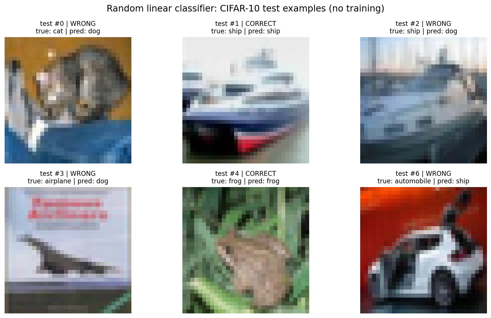
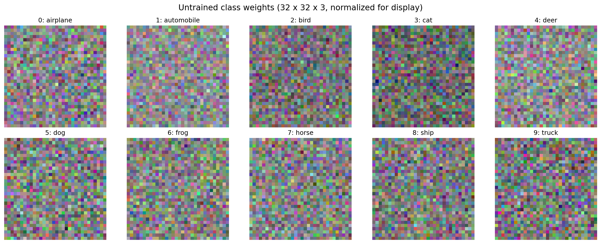

# CIFAR-10 무작위 선형 분류기 — 실행 결과 및 해설

## 1. 환경 및 실험 설정

- 입력: `uint8` 픽셀을 `[0, 1]`로 나눈 뒤, CIFAR 공식 채널 순서 그대로 3,072차원 벡터로 사용.
- 시드: **42**, 가중치: `W ~ N(0, 0.01²)` / `W.shape=(10,3072)`, 편향: `b=0`.
- 점수 계산: `f(x)=Wx+b`; 최고 점수 `argmax`가 예측 클래스.

## 2. 예시 이미지와 예측 결과

| test 인덱스 | 실제 클래스 | 예측 클래스 | 결과 | hinge loss | 확률 합 |
|---|---|---|---|---|---|
| 0 | cat | dog | 오답 | 14.454526 | 1.000000000000 |
| 1 | ship | ship | 정답 | 2.754030 | 1.000000000000 |
| 2 | ship | dog | 오답 | 4.067474 | 1.000000000000 |
| 3 | airplane | dog | 오답 | 15.235916 | 1.000000000000 |
| 4 | frog | frog | 정답 | 3.573214 | 1.000000000000 |
| 6 | automobile | ship | 오답 | 10.686078 | 1.000000000000 |

## 3. 모든 클래스 점수와 Softmax 확률

아래 표에서 `score`는 제한 없는 실수 점수이고, `softmax`는 0~1 사이 확률 형태의 값입니다. 가장 큰 score와 가장 큰 softmax는 같은 클래스를 가리킵니다.

### test #0 — 실제 cat, 예측 dog

| 클래스(ID) | 원점수 score | Softmax 확률 |
|---|---|---|
| airplane (0) | -0.155977 | 0.067603 |
| automobile (1) | +0.305281 | 0.107223 |
| bird (2) | -0.143712 | 0.068437 |
| cat (3) | -0.360996 | 0.055072 |
| deer (4) | +0.175156 | 0.094140 |
| dog (5) | +0.588500 | 0.142327 |
| frog (6) | +0.553838 | 0.137478 |
| horse (7) | +0.461676 | 0.125374 |
| ship (8) | +0.483354 | 0.128122 |
| truck (9) | -0.062553 | 0.074223 |

- 최고 점수 클래스: **dog**; 확률 합: **1.000000000000**; 해당 이미지 hinge loss: **14.454526**

### test #1 — 실제 ship, 예측 ship

| 클래스(ID) | 원점수 score | Softmax 확률 |
|---|---|---|
| airplane (0) | -0.411500 | 0.049521 |
| automobile (1) | +0.231841 | 0.094230 |
| bird (2) | -0.182888 | 0.062241 |
| cat (3) | -0.731980 | 0.035942 |
| deer (4) | +0.270982 | 0.097992 |
| dog (5) | +0.759060 | 0.159646 |
| frog (6) | +0.659302 | 0.144489 |
| horse (7) | +0.363885 | 0.107532 |
| ship (8) | +0.906208 | 0.184954 |
| truck (9) | -0.163606 | 0.063453 |

- 최고 점수 클래스: **ship**; 확률 합: **1.000000000000**; 해당 이미지 hinge loss: **2.754030**

### test #2 — 실제 ship, 예측 dog

| 클래스(ID) | 원점수 score | Softmax 확률 |
|---|---|---|
| airplane (0) | -0.398882 | 0.054135 |
| automobile (1) | +0.418661 | 0.122612 |
| bird (2) | -0.153281 | 0.069205 |
| cat (3) | -0.717223 | 0.039375 |
| deer (4) | +0.106580 | 0.089742 |
| dog (5) | +0.698583 | 0.162218 |
| frog (6) | +0.403079 | 0.120716 |
| horse (7) | +0.457534 | 0.127472 |
| ship (8) | +0.651842 | 0.154811 |
| truck (9) | -0.300787 | 0.059714 |

- 최고 점수 클래스: **dog**; 확률 합: **1.000000000000**; 해당 이미지 hinge loss: **4.067474**

### test #3 — 실제 airplane, 예측 dog

| 클래스(ID) | 원점수 score | Softmax 확률 |
|---|---|---|
| airplane (0) | -0.392948 | 0.048072 |
| automobile (1) | +0.351185 | 0.101174 |
| bird (2) | -0.294679 | 0.053036 |
| cat (3) | -0.485606 | 0.043818 |
| deer (4) | +0.242395 | 0.090745 |
| dog (5) | +0.858305 | 0.167999 |
| frog (6) | +0.796027 | 0.157856 |
| horse (7) | +0.576938 | 0.126798 |
| ship (8) | +0.686945 | 0.141542 |
| truck (9) | -0.032122 | 0.068960 |

- 최고 점수 클래스: **dog**; 확률 합: **1.000000000000**; 해당 이미지 hinge loss: **15.235916**

### test #4 — 실제 frog, 예측 frog

| 클래스(ID) | 원점수 score | Softmax 확률 |
|---|---|---|
| airplane (0) | -0.463323 | 0.052784 |
| automobile (1) | -0.004732 | 0.083496 |
| bird (2) | -0.086047 | 0.076975 |
| cat (3) | -0.404574 | 0.055978 |
| deer (4) | +0.001821 | 0.084045 |
| dog (5) | +0.429352 | 0.128880 |
| frog (6) | +0.663848 | 0.162940 |
| horse (7) | +0.366189 | 0.120992 |
| ship (8) | +0.650202 | 0.160731 |
| truck (9) | -0.136638 | 0.073178 |

- 최고 점수 클래스: **frog**; 확률 합: **1.000000000000**; 해당 이미지 hinge loss: **3.573214**

### test #6 — 실제 automobile, 예측 ship

| 클래스(ID) | 원점수 score | Softmax 확률 |
|---|---|---|
| airplane (0) | -0.326873 | 0.066926 |
| automobile (1) | -0.128259 | 0.081630 |
| bird (2) | -0.005779 | 0.092267 |
| cat (3) | -0.355171 | 0.065059 |
| deer (4) | -0.075405 | 0.086061 |
| dog (5) | +0.376168 | 0.135183 |
| frog (6) | +0.321060 | 0.127935 |
| horse (7) | +0.227961 | 0.116562 |
| ship (8) | +0.397813 | 0.138141 |
| truck (9) | -0.028030 | 0.090236 |

- 최고 점수 클래스: **ship**; 확률 합: **1.000000000000**; 해당 이미지 hinge loss: **10.686078**

## 4. 다중 클래스 SVM hinge loss

- 예시 6개 평균 손실: **8.461873**
- 정답을 예측했더라도 2등 이하의 점수들과 margin(1.0)을 충분히 벌리지 못하면 hinge loss는 0보다 클 수 있습니다.
- 위 평균은 의도적으로 선정한 몇 개 예시의 평균이지 CIFAR-10 전체 테스트셋 평균은 아닙니다.

## 5. Softmax 원점수와 확률의 차이

- 모든 예시에서 확률의 합이 1인지 검사: **통과** (`np.allclose`, atol=1e-12).
- Softmax는 점수 순서를 바꾸지 않으므로 예측 클래스를 바꾸지 않습니다. 단, 학습되지 않은 모델의 softmax 값을 *신뢰할 수 있는 예측 확률*이라고 해석할 수는 없습니다.

## 6. 정답/오답 사례 해석

- **정답 사례:** test #1의 실제 클래스는 `ship`이고, 무작위 점수의 최대값도 `ship`에 해당합니다. 다만 올바른 특징을 학습한 결과라고 볼 수는 없습니다.
- **오답 사례:** test #0의 실제 클래스는 `cat`이지만 점수 최댓값은 `dog`이므로 잘못 분류되었습니다.
- 가중치가 무작위 상태에서 고정되어 있기 때문에 이미지 속 사물의 모양이나 의미에 맞는 판단 기준이 만들어지지 않았습니다. 우연히 맞는 이미지가 있더라도 학습 효과는 아닙니다.

## 7. 클래스별 32×32×3 가중치 시각화

- `W`의 원소 평균: **+0.00009071**, 표준편차: **0.01004367**, 범위: **[-0.043891, +0.041512]**.
- 행렬 `W`의 각 행(클래스별 3,072차원 가중치)을 CIFAR의 RGB 채널 순서에 맞춰 `(3,32,32) → (32,32,3)`으로 변형했습니다.
- 이미지 출력 시에만 클래스별 min-max 정규화를 적용하여 눈에 보이도록 했고, 실제 계산에 사용한 `W`는 수정하지 않았습니다.
- 그림에 불규칙한 색 잡음이 나타나는 이유는 각 픽셀 가중치가 무작위로 정해졌고 학습·업데이트가 전혀 없기 때문입니다. 물체의 윤곽, 색 또는 질감을 특정 클래스와 연결하는 구조를 학습하지 못했습니다.

